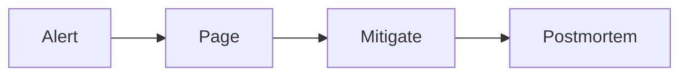

Booklet renders GitHub-Flavored Markdown and a few additions. Raw HTML in a document is not rendered.

## The basics

Headings, bold, italic, strikethrough, inline code, links, images (by URL), blockquotes, ordered and unordered lists with nesting, task lists, tables with column alignment, horizontal rules and footnotes.

A document with three or more headings gets a table of contents.

## Code

A fenced block with a language name is highlighted. A long block is collapsed on the published page with a button to expand it.

````markdown
```yaml
pool_size: 50
```
````

## Math

KaTeX. Inline between single dollar signs, `$e = mc^2$`, and as a block between double dollar signs:

```markdown
$$
p_{95} = \mu + 1.645\,\sigma
$$
```

## Diagrams

A fenced block with the language `mermaid` is drawn as a Mermaid diagram, and `dot` or `graphviz` as a Graphviz one. Diagrams are drawn in the reader's browser, and into the HTML export.

````markdown

````

## Callouts

A blockquote that starts with a marker becomes a callout. The markers are `NOTE`, `TIP`, `IMPORTANT`, `WARNING` and `CAUTION`.

```markdown
> [!WARNING]
> Do not restart the primary while a backup is running.
```

## Toggles

A section the reader can open and close:

```markdown
:::toggle[Full stack trace]

The content, in any Markdown.

:::
```

## Columns

Two to four columns, separated by a line of three hyphens. They stack on a narrow screen.

```markdown
:::columns

**Before**

Pool size 5.

---

**After**

Pool size 50.

:::
```

## Links between pages

`[[Title of another page]]` becomes a link when you publish: see [Linking documents](/docs/guides/linking).
